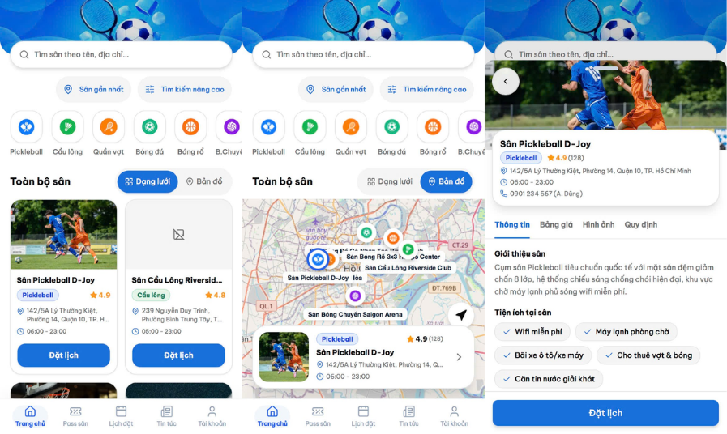
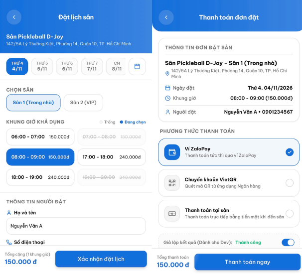
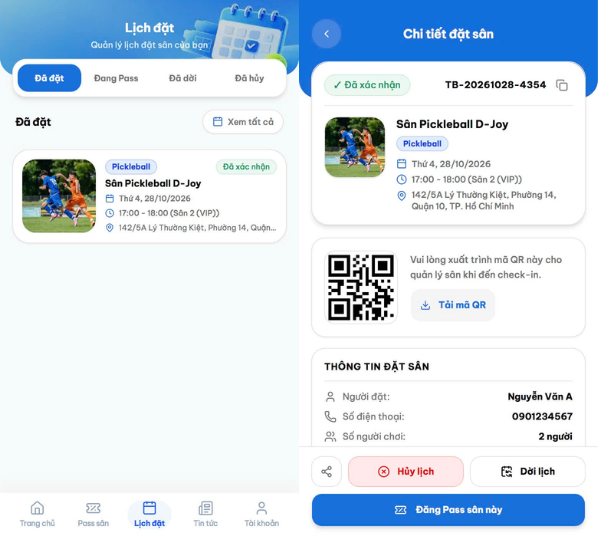
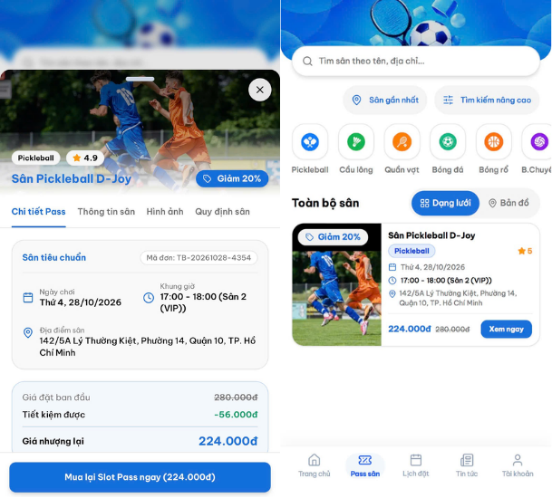

# BOTI – Zalo Mini App đặt sân thể thao

BOTI là Zalo Mini App hỗ trợ người dùng tìm kiếm, đặt và quản lý lịch đặt sân thể thao. Ứng dụng cung cấp các chức năng như tìm kiếm sân, đặt sân, quản lý lịch đặt, chuyển nhượng lượt đặt sân và cập nhật thông tin cá nhân.

**Live Demo:** [https://boti-lemon.vercel.app/](https://boti-lemon.vercel.app/)

---

## Screenshots

<!-- Thay thế các đường dẫn bên dưới bằng đường dẫn ảnh thực tế của dự án -->

### Trang chủ



### Đặt sân và thanh toán



### Quản lý lịch đặt sân



### Chuyển nhượng sân



### Tin tức và hồ sơ cá nhân


---

## Features

- **Tìm kiếm sân thể thao:** Hiển thị danh sách sân dưới dạng lưới hoặc bản đồ, hỗ trợ lọc theo địa điểm và loại hình thể thao.
- **Đặt sân:** Xem thông tin sân và thực hiện quy trình đặt sân.
- **Quản lý lịch đặt:** Xem lịch sử đặt sân, hủy lịch và đổi lịch theo các điều kiện hỗ trợ.
- **Chuyển nhượng sân:** Chuyển lượt đặt sân cho người khác, chỉnh sửa hoặc hủy thông tin chuyển nhượng.
- **Thanh toán:** Giao diện và luồng thanh toán mô phỏng.
- **Tin tức:** Hiển thị nội dung tin tức liên quan đến hoạt động thể thao.
- **Quản lý hồ sơ:** Xem và cập nhật thông tin cá nhân.

---

## Tech Stack

| Công nghệ                                           | Vai trò                                |
| --------------------------------------------------- | -------------------------------------- |
| [Next.js 16](https://nextjs.org/)                   | React framework, App Router            |
| [React 19](https://react.dev/)                      | Xây dựng giao diện người dùng          |
| [TypeScript](https://www.typescriptlang.org/)       | Kiểm soát kiểu dữ liệu                 |
| [Tailwind CSS 4](https://tailwindcss.com/)          | Styling giao diện                      |
| [Zustand](https://zustand.docs.pmnd.rs/)            | Quản lý trạng thái toàn cục            |
| [TanStack Query](https://tanstack.com/query/latest) | Quản lý truy vấn và trạng thái dữ liệu |
| [Axios](https://axios-http.com/)                    | Xử lý HTTP requests                    |
| [React Hook Form](https://react-hook-form.com/)     | Quản lý biểu mẫu                       |
| [Zod](https://zod.dev/)                             | Kiểm tra và xác thực dữ liệu           |
| [shadcn/ui](https://ui.shadcn.com/)                 | Các thành phần giao diện               |
| [Lucide React](https://lucide.dev/)                 | Hệ thống biểu tượng                    |
| [Framer Motion](https://motion.dev/)                | Hiệu ứng và chuyển động giao diện      |
| [Leaflet](https://leafletjs.com/)                   | Hiển thị bản đồ                        |

---

## Project Structure

Dự án được tổ chức theo hướng **Feature-based Architecture**, phân chia các chức năng thành những module riêng biệt nhằm tăng khả năng tái sử dụng, bảo trì và mở rộng.

```text
src/
├── app/                  # Next.js App Router và các trang
│   ├── bookings/         # Trang đặt sân và quản lý đặt sân
│   ├── checkout/         # Trang thanh toán
│   ├── home/             # Trang chủ
│   ├── news/              # Trang tin tức
│   ├── pass/              # Trang chuyển nhượng sân
│   ├── profile/           # Trang hồ sơ cá nhân
│   ├── globals.css        # Global styles
│   ├── layout.tsx         # Root layout
│   └── page.tsx           # Entry page
│
├── assets/                # Tài nguyên tĩnh
│   ├── icons/
│   └── images/
│
├── components/            # Components dùng chung
│   ├── common/
│   ├── layout/
│   ├── motion/
│   └── ui/
│
├── constants/             # Các hằng số
├── data/                  # Dữ liệu tĩnh và dữ liệu mock
│
├── features/              # Các module chức năng
│   ├── bookings/
│   ├── checkout/
│   ├── home/
│   ├── news/
│   └── profile/
│
├── lib/                   # Các thư viện và cấu hình dùng chung
├── providers/             # Các context providers
├── services/              # Xử lý API và dịch vụ dữ liệu
├── stores/                # Global state với Zustand
├── types/                 # TypeScript types
└── utils/                 # Các hàm tiện ích
```

---

## Getting Started

### Prerequisites

Đảm bảo môi trường phát triển đã cài đặt:

- [Node.js](https://nodejs.org/)
- npm (được cài đặt cùng Node.js)

### Installation

**1. Clone repository**

```bash
git clone <repository-url>
```

**2. Navigate to project directory**

```bash
cd boti
```

**3. Install dependencies**

```bash
npm install
```

**4. Start development server**

```bash
npm run dev
```

Mở trình duyệt tại:

```text
http://localhost:3000
```

---

## Available Scripts

| Command         | Description                   |
| --------------- | ----------------------------- |
| `npm run dev`   | Khởi chạy development server  |
| `npm run build` | Build ứng dụng cho production |
| `npm run start` | Khởi chạy production server   |
| `npm run lint`  | Kiểm tra mã nguồn bằng ESLint |

---

## Architecture & Data Handling

BOTI sử dụng cách tổ chức mã nguồn theo từng chức năng kết hợp với các lớp xử lý dùng chung:

- **App Router:** Quản lý routing và cấu trúc trang ứng dụng.
- **Features:** Tách biệt logic và thành phần giao diện theo từng nghiệp vụ.
- **Components:** Tái sử dụng các thành phần giao diện giữa nhiều trang.
- **Services:** Tập trung xử lý các thao tác liên quan đến dữ liệu và API.
- **Stores:** Quản lý trạng thái dùng chung bằng Zustand.
- **TanStack Query:** Quản lý truy vấn, trạng thái tải và cache dữ liệu.
- **React Hook Form & Zod:** Quản lý biểu mẫu và kiểm tra dữ liệu đầu vào.

---

## Current Limitations

BOTI hiện là phiên bản Frontend Demo với một số giới hạn:

- Dữ liệu được xử lý thông qua Mock API, chưa kết nối Backend thực tế.
- Chức năng thanh toán mới mô phỏng giao diện và luồng thao tác, chưa thực hiện giao dịch thật.
- Một số dữ liệu và thao tác được mô phỏng để phục vụ việc trình diễn các chức năng của ứng dụng.

---

## Demo

Trải nghiệm phiên bản demo tại:

**[BOTI – Live Demo](https://boti-lemon.vercel.app/)**

---

## License

This project is developed for learning and demonstration purposes.
